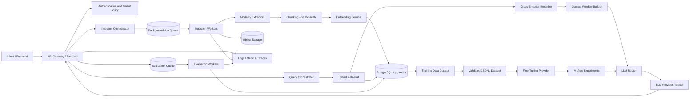
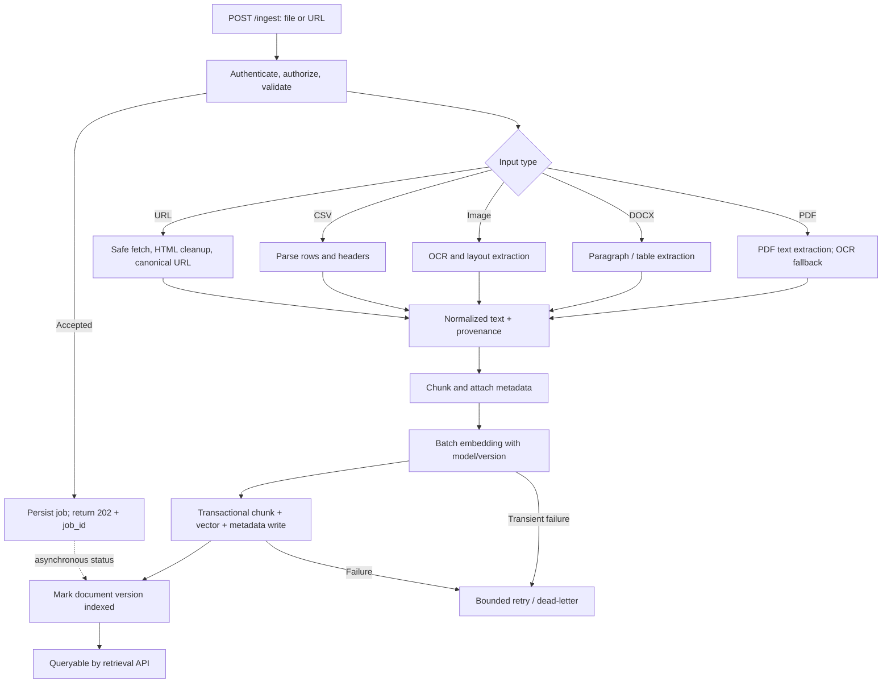
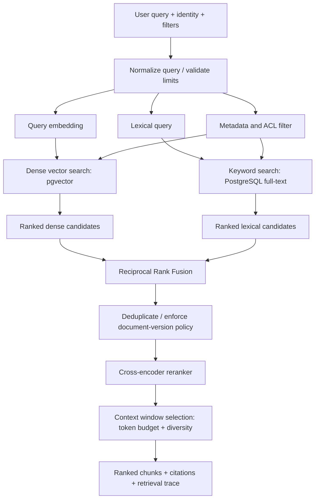
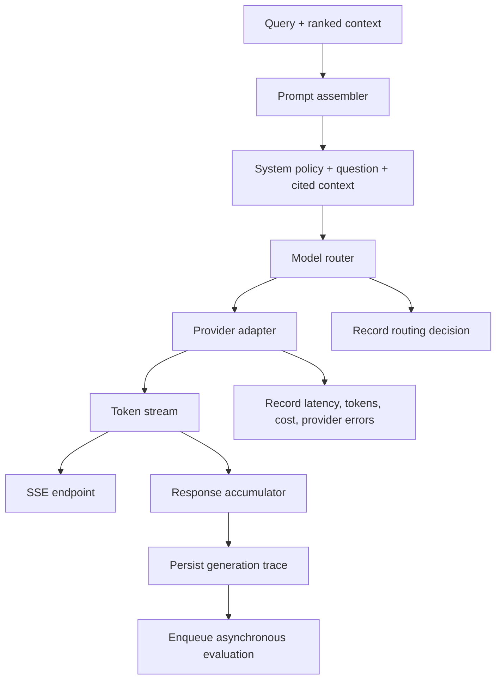
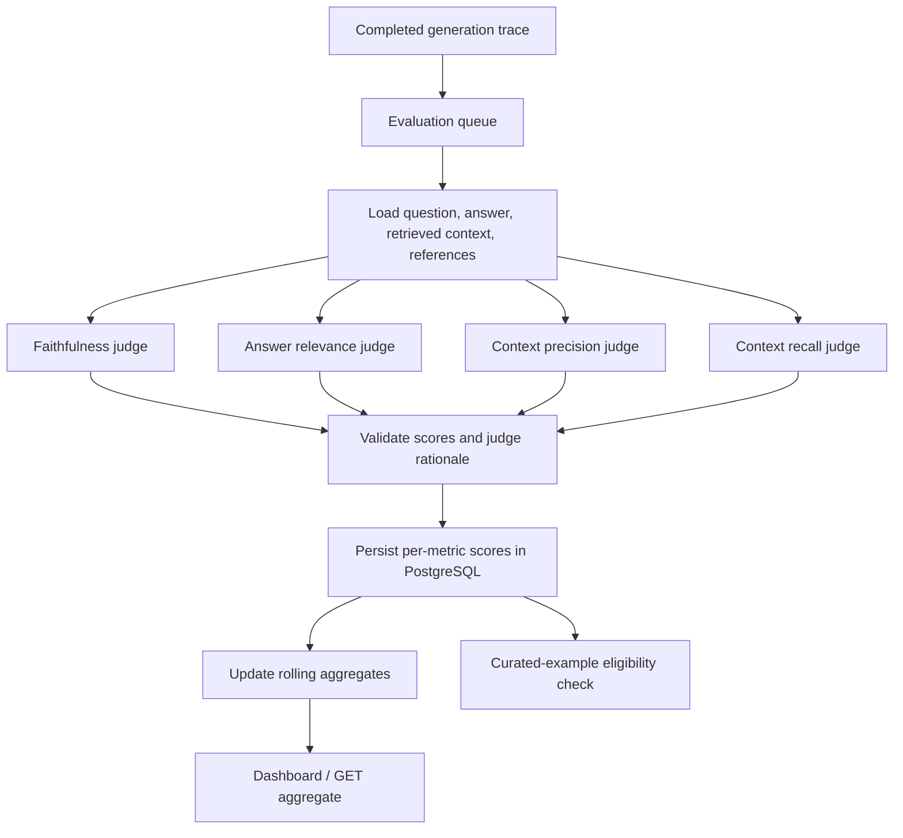
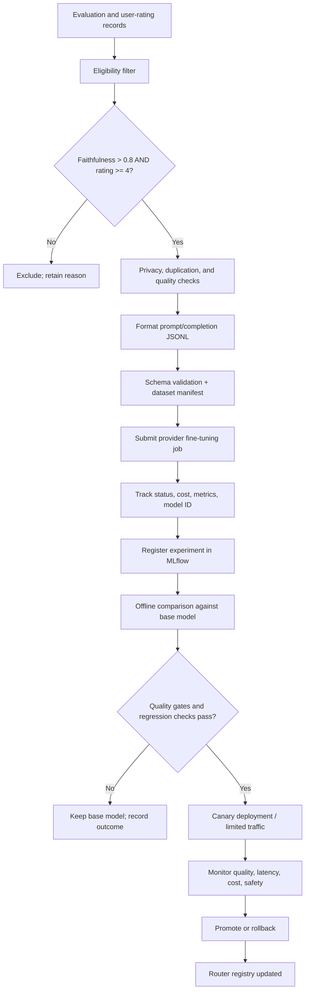

# NeuroFlow System Architecture

**Status:** Proposed architecture for Task 31  
**Scope:** Logical components, data flow, interfaces, reliability, and observability. This document defines the intended behavior, not a claim that the services have already been implemented.

## 1. System boundaries and core principles

NeuroFlow is a multi-stage RAG system. The API layer authenticates callers and coordinates work; PostgreSQL is the system of record for document metadata, chunks, evaluation records, pipeline definitions, and vector embeddings through pgvector. Object storage holds original uploads and large extracted artifacts. Background workers handle ingestion, evaluation, and fine-tuning so user-facing requests do not wait for long-running jobs.

**Core invariants**

1. A chunk is queryable only after its text, metadata, embedding, and document-version association are committed successfully.
2. Retrieval is permission-filtered: tenant and access-control filters are applied before context reaches a model.
3. Every generated answer has a traceable query ID, model/provider/version, prompt configuration, retrieved chunk IDs, and timestamps.
4. Evaluation is asynchronous and cannot change the already-delivered answer.
5. Fine-tuned models are not promoted until offline evaluation and operational guardrails pass.
6. Retries are bounded and idempotency keys are used for externally retried write requests where practical.

## 2. High-level component diagram

## 3. Ingestion subsystem

### Responsibilities

Accept PDF, DOCX, images, CSV, and web URLs; validate and persist the source; extract text and modality-specific structure; normalize content; split it into chunks; attach provenance and access metadata; embed chunks; and write searchable records.

### Data flow: upload to first queryable vector

### Processing contract

1. **Validate:** allow only configured MIME types/extensions; enforce byte/page/row limits; inspect actual file signatures rather than trusting filenames. URL ingestion must allow only HTTP(S), reject private/loopback/link-local destinations, re-check redirects and DNS resolutions, and enforce response-size/time limits to reduce SSRF risk.
2. **Persist:** store original files in object storage under opaque keys. Store source URI, checksum, tenant, uploader, timestamps, and processing status in PostgreSQL.
3. **Extract by modality:** use a parser for PDF and DOCX, OCR for image/scanned content, structured row-aware parsing for CSV, and sanitized HTML extraction for web pages. Preserve page number, heading, row range, URL, and other available provenance.
4. **Normalize:** remove extraction artifacts without destroying code, table values, citations, or meaningful whitespace. Record extractor name/version and extraction warnings.
5. **Chunk:** use the policy in ADR 002. Keep chunks associated with document version and source offsets. Do not mix tenant/security boundaries in one chunk.
6. **Embed:** batch requests; record embedding model, model version, dimensions, and normalization assumptions. A vector index must not mix incompatible embedding dimensions or models without explicit separation.
7. **Commit:** upsert chunk text/metadata and vector in a transaction or in a staged state that prevents partially written chunks from appearing in retrieval. Mark a document version `indexed` only after all required writes succeed.
8. **Retry and cleanup:** use idempotent job IDs/checksums; bound retries; surface terminal failures; remove or expire abandoned staging records.

**Queryability definition:** a chunk is queryable when it is committed, belongs to an indexed document version, has a compatible embedding, and passes tenant/access filters.

## 4. Retrieval subsystem

### Full hybrid retrieval pipeline

### Retrieval behavior

- Dense search captures semantic similarity; lexical search preserves exact identifiers, names, error codes, and rare terms. Metadata filters constrain tenant, ACL, document, source, date, and optional user filters.
- Dense and lexical searches execute concurrently. ACL/tenant restrictions must be enforced in the database query path and not merely applied after candidate retrieval.
- Fuse the ranked lists using Reciprocal Rank Fusion. For a candidate \(d\), the conceptual score is `RRF(d) = Σ 1 / (k + rank_i(d))`, with a configured constant (initial default `k = 60`). Do not compare raw vector and lexical scores as if they shared a scale.
- Deduplicate by chunk ID; apply document-version and freshness rules; rerank a bounded candidate set with a cross-encoder; then select context under a token budget.
- Return chunk IDs, document/source identifiers, page/row/URL provenance, retrieval ranks, and scores for observability. Only the final selected context is passed to generation.
- If retrieval is empty or below a calibrated threshold, return a grounded abstention or ask a clarifying question instead of inventing evidence.

**Initial configurable defaults:** retrieve up to 40 dense and 40 lexical candidates; RRF merge; rerank top 30; select context within a model-specific token budget. These are starting points to tune using evaluation, not universal constants.

## 5. Generation subsystem

### Prompt assembly and routing

- Build a versioned prompt from system policy, the user's question, selected context with stable citation IDs, and output-format requirements.
- Clearly delimit retrieved content as untrusted evidence. Instructions found inside documents must not override system policy.
- The router considers required capability, query domain, context length, structured-output/tool needs, latency SLO, provider health, and cost budget. ADR 004 defines the initial routing matrix.
- Use provider adapters so model-specific APIs, retry behavior, token usage, and stream events do not leak into the API contract.
- Stream response deltas to clients over SSE. Persist the completed input/output pair, model metadata, context chunk IDs, prompt version, token usage, and timings. Redact secrets and apply retention policies to sensitive content.
- If a provider fails before streaming, a bounded fallback may select another eligible model. After output has started, avoid silently restarting with a different model because it can duplicate or contradict already-delivered tokens; emit a stream error event and record the partial output.

## 6. Evaluation subsystem

### Metric definitions

- **Faithfulness:** how much of the answer's factual content is supported by the retrieved context.
- **Answer relevance:** how directly and completely the answer addresses the user's question.
- **Context precision:** the proportion of retrieved context judged relevant/useful, with rank-aware reporting added where appropriate.
- **Context recall:** how much of the reference-relevant evidence is present in the retrieved context. This metric needs a reference answer, evidence labels, or another explicitly defined reference; it must not be treated as fully observable from the query alone.

Each score is normalized to `[0, 1]`; store evaluator/model version, rubric version, evidence/rationale, status, and timestamps. Failed evaluations are marked failed and retried with bounded policy rather than represented as zero. Aggregates include sample count, time window, mean and percentile distributions where meaningful, and breakdowns by model, domain, pipeline, and prompt version.

Evaluation runs asynchronously after a generation is completed. It must not delay the response. Track judge latency/cost and periodically compare a stratified sample against human labels to detect drift, position bias, prompt injection, and judge/model correlation. See ADR 003.

## 7. Fine-tuning subsystem

### Curation and promotion rules

- Select examples only when `faithfulness > 0.8` **and** the user's rating is `>= 4`, while also requiring valid consent/usage rights and excluding secrets, personal data that should not be used, duplicate examples, unsafe content, and malformed traces.
- Define the training pair explicitly: input contains the task/question and only the permitted conversational context; completion contains the validated target answer. Do not automatically treat every retrieved chunk as training ground truth.
- Split train/validation sets by source or time where needed to avoid leakage. Version the dataset, filter rules, tokenizer/model, and manifest. Validate JSONL syntax and provider-specific requirements before submission.
- Track job lifecycle, provider job ID, base/fine-tuned model IDs, dataset hash, metrics, and cost in PostgreSQL; use MLflow for experiment parameters, metrics, artifacts, and comparisons.
- A fine-tuned model is eligible for routing only when it beats or matches the base model on predeclared domain-specific quality gates, has no unacceptable safety/faithfulness regression, and meets latency/cost requirements. Use canary rollout and immediate rollback.
- Fine-tuning is not a substitute for fresh knowledge retrieval. Continue using RAG for source-grounded, changing, or access-controlled information.

## 8. Cross-cutting data and operational design

- **System of record:** PostgreSQL for relational metadata, pipeline definitions/runs, traces, evaluations, and pgvector embeddings. Object storage for originals and large artifacts. MLflow for experiment tracking, not as the transactional source of truth.
- **Async work:** ingestion, evaluation, and fine-tuning are jobs with stable IDs and explicit states (`queued`, `running`, `succeeded`, `failed`, optionally `cancelled`). Use a durable queue in implementation; define retry limits and dead-letter handling.
- **Observability:** structured logs, request/trace IDs, queue age/depth, ingestion failure rate, retrieval latency, reranker latency, time-to-first-token, total generation latency, tokens/cost, evaluation backlog, score distributions, and fine-tuning job outcomes.
- **Security:** authenticated user endpoints; tenant/ACL enforcement; TLS and secret management; safe URL fetch; upload limits; content-type validation; prompt-injection-aware context handling; data retention and deletion workflows.
- **Resilience:** request timeouts, bounded exponential backoff with jitter, provider circuit breakers, idempotency, graceful degradation when lexical/vector retrieval or a provider is unavailable, and explicit partial-failure status.
- **Versioning:** version API schemas, prompt templates, embedding models, chunking policy, evaluation rubrics, datasets, and model-routing policy. Record versions in traces so results are reproducible.

## 9. Key quality indicators

Track at minimum: ingestion success rate and time-to-queryable; retrieval recall@k and nDCG@k on labeled queries; time-to-first-token and end-to-end latency; faithfulness, relevance, context precision, and context recall; cost per successful answer; evaluation queue lag; and base-versus-fine-tuned quality deltas. Set targets after establishing a representative baseline dataset rather than inventing universal thresholds.
