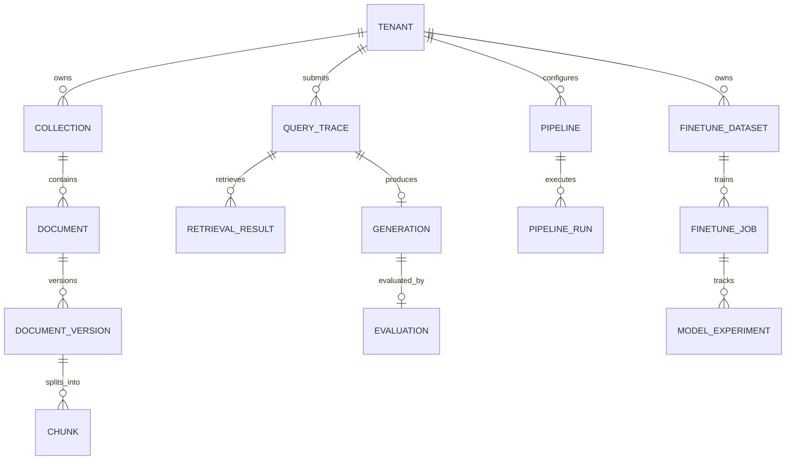

# NeuroFlow Data Models

**Status:** Proposed logical schema. Physical migrations and exact SQL types will be implemented in later tasks.

## Conventions

- Primary identifiers are UUIDs unless noted.
- Tenant-scoped records carry `tenant_id`; all reads and writes enforce tenant isolation.
- `created_at` and `updated_at` are UTC timestamps.
- JSON fields are for bounded, versioned configuration or provenance, not unvalidated executable input.
- Secrets and raw provider credentials are never stored in these records.

## Entity relationships

## Core entities

### `tenants`
- `id` UUID primary key
- `name` string
- `status` enum: `active`, `suspended`
- `created_at`, `updated_at`

### `collections`
- `id` UUID primary key; `tenant_id` foreign key
- `name`, `description`
- `default_acl` JSON / policy reference
- `created_at`, `updated_at`
- Unique constraint: `(tenant_id, name)`

### `documents`
Represents a logical source across versions.
- `id` UUID primary key; `tenant_id`, `collection_id` foreign keys
- `source_type` enum: `upload`, `url`
- `source_uri` nullable string; `object_key` nullable string
- `content_hash` string; `display_name` string
- `metadata` JSONB
- `created_by`, `created_at`, `updated_at`

### `document_versions`
- `id` UUID primary key; `document_id`, `tenant_id` foreign keys
- `version_number` integer
- `status` enum: `queued`, `extracting`, `chunking`, `embedding`, `indexed`, `failed`, `superseded`
- `extractor_name`, `extractor_version`
- `chunking_profile`, `embedding_model_id`, `embedding_dimensions`
- `error_code` nullable; `error_summary` nullable
- `started_at`, `indexed_at`, `created_at`
- Unique constraint: `(document_id, version_number)`

### `chunks`
- `id` UUID primary key; `tenant_id`, `document_id`, `document_version_id` foreign keys
- `chunk_index` integer; `text` text
- `token_count` integer
- `content_hash` string
- `source_start` / `source_end` nullable integer or structured offsets
- `provenance` JSONB: page, heading, row range, URL, etc.
- `metadata` JSONB
- `embedding` pgvector column with dimensions fixed by the selected embedding profile/table/index
- `embedding_model_id` string; `created_at`
- Unique constraint: `(document_version_id, chunk_index)`
- Indexes: tenant/document lookup; metadata GIN where useful; vector index selected after workload testing; lexical full-text index.

**Important:** if multiple embedding models or dimensions must coexist, isolate them by table/partition/index/profile rather than comparing incompatible vectors.

### `ingestion_jobs`
- `id` UUID primary key; `tenant_id`, `document_id`, `document_version_id`
- `status` enum: `queued`, `running`, `succeeded`, `failed`, `cancelled`
- `attempt_count`, `idempotency_key`
- `progress` JSONB; `error_code`, `error_summary`
- `created_at`, `started_at`, `finished_at`
- Unique idempotency scope: `(tenant_id, idempotency_key)` when key is present.

### `pipelines`
- `id` UUID primary key; `tenant_id`
- `name`, `description`
- `version` integer; `config` JSONB; `schema_version`
- `enabled` boolean; `created_by`, `created_at`, `updated_at`
- Unique constraint: `(tenant_id, name, version)`

### `pipeline_runs`
- `id` UUID primary key; `tenant_id`, `pipeline_id`
- `pipeline_version`, `status`
- `input_count`, `success_count`, `failure_count`
- `metrics` JSONB; `error_summary`
- `started_at`, `finished_at`, `created_at`

### `query_traces`
- `id` UUID primary key; `tenant_id`, `user_id` nullable
- `question_redacted` text or protected payload reference
- `collection_ids` UUID array; `filters` JSONB
- `routing_request` JSONB; `routing_decision` JSONB
- `prompt_version`, `pipeline_id`, `pipeline_version`
- `status` enum: `queued`, `retrieving`, `generating`, `completed`, `failed`, `cancelled`
- `request_id`, `created_at`, `completed_at`
- Apply retention and access policies to user query content.

### `retrieval_results`
- `id` UUID primary key; `query_id`, `tenant_id`, `chunk_id`
- `dense_rank`, `lexical_rank`, `rrf_score`, `reranker_score`
- `selected_for_context` boolean; `context_position` nullable integer
- `created_at`
- Preserve candidate ranks for retrieval evaluation and debugging.

### `generations`
- `id` UUID primary key; `query_id` unique foreign key; `tenant_id`
- `model_provider`, `model_id`, `model_version`
- `prompt_template_version`, `system_policy_version`
- `input_tokens`, `output_tokens`, `estimated_cost`
- `time_to_first_token_ms`, `total_latency_ms`
- `input_payload_ref` / `output_payload_ref` or encrypted/redacted payloads subject to retention policy
- `status`, `error_code`, `created_at`, `completed_at`
- `user_rating` nullable integer constrained to 1–5

### `evaluations`
- `id` UUID primary key; `tenant_id`, `query_id`, `generation_id`
- `status` enum: `queued`, `running`, `succeeded`, `failed`
- `faithfulness`, `answer_relevance`, `context_precision`, `context_recall` nullable floats constrained to `[0,1]`
- `evaluator_model_id`, `evaluator_version`, `rubric_version`
- `rationales` JSONB; `reference_source` nullable string
- `attempt_count`, `error_code`, `created_at`, `completed_at`
- Indexes on tenant/time, status/time, model/version, and query ID.

### `evaluation_aggregates`
Optional materialized/rollup table; raw evaluations remain authoritative.
- `id` UUID primary key; `tenant_id`
- `window_start`, `window_end`, `group_dimensions` JSONB
- `sample_count`, `metric_means` JSONB, `metric_percentiles` JSONB
- `computed_at`, `aggregation_version`

### `finetune_datasets`
- `id` UUID primary key; `tenant_id`
- `name`, `dataset_version`, `storage_uri`, `content_hash`
- `example_count`, `source_evaluation_ids` JSONB or normalized relation
- `filter_policy_version`, `schema_version`, `status`
- `created_at`, `created_by`
- Dataset artifacts are immutable once a job references their hash.

### `finetune_jobs`
- `id` UUID primary key; `tenant_id`, `dataset_id`
- `provider`, `provider_job_id`, `base_model_id`, `fine_tuned_model_id`
- `status`, `hyperparameters` JSONB, `provider_metrics` JSONB
- `promotion_status`, `failure_code`, `failure_summary`
- `created_at`, `updated_at`, `finished_at`

### `model_experiments`
- `id` UUID primary key; `tenant_id`, `finetune_job_id`
- `mlflow_experiment_id`, `mlflow_run_id`
- `dataset_hash`, `base_model_id`, `candidate_model_id`
- `evaluation_report_uri`, `metrics` JSONB
- `decision` enum: `pending`, `rejected`, `canary`, `promoted`, `rolled_back`
- `created_at`, `decided_at`

## Data lifecycle and consistency

1. Source objects are stored before asynchronous extraction begins; metadata points to the object key.
2. A document version is not marked `indexed` until all expected chunk/vector writes succeed.
3. Deleting a document must remove or tombstone its chunks and vectors and invalidate cached retrieval results according to retention policy.
4. Query traces, retrieval results, generation payloads, and evaluation rows share traceable IDs.
5. User ratings and evaluation records are access-controlled and never used for training without policy/consent checks.
6. Aggregates are reproducible from raw evaluation records and include the aggregation version and sample count.
7. Fine-tuning datasets are immutable snapshots with hashes; promotion decisions retain the exact evaluation report and policy version.
